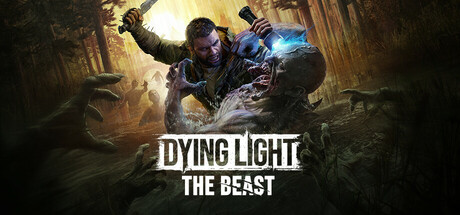

**Dying Light: The Beast by Techland (2025) returns Kyle Crane in a standalone chapter set in the rural Castor Woods region.**

---

## 📖 About

Dying Light: The Beast by Techland (2025) returns Kyle Crane in a standalone chapter set in the rural Castor Woods region. It blends the series' signature parkour with beast transformation mechanics and introduces a new infected variant called the Beast that stalks the player through the environment.

## ⚠️ Problems Without Trainer

| Problem | Status |
|---------|--------|
| Volatiles and Beast encounters in night hours kill without proper preparation | ✅ Solved |
| Immunity boosters deplete rapidly during extended outdoor night missions | ✅ Solved |
| Blueprint crafting materials for effective weapons require hours of looting | ✅ Solved |
| Parkour stamina runs out at critical traversal moments under pursuit | ✅ Solved |
| Faction reputation gated unlocks require completing chains of boring errands | ✅ Solved |

## ✅ Solution

The **Dying Light: The Beast Trainer** solves all these issues, giving you complete control so you can focus on enjoying the game.

## 🎯 Features

- Unlimited Resources / Currency
- God Mode / Invincibility
- Instant Skill & Ability Cooldown
- One-Hit Kill
- Freeze Timers
- Unlock All Items & Achievements
- Custom Speed Multiplier
- Infinite Stamina / Energy

## 🚀 Quick Start

1. **Disable Windows Defender** temporarily (trainer may trigger false positive)
2. Get the trainer from the button above
3. Launch Dying Light: The Beast
4. Run the trainer as Administrator
5. Use the hotkeys to activate cheats in-game

## 💎 Free vs Pro

| Feature | Free | Pro |
|---------|------|-----|
| God Mode | ✅ | ✅ |
| Unlimited Resources | ✅ | ✅ |
| Advanced Cheats | ❌ | ✅ |
| Auto-Updates | ❌ | ✅ |
| Priority Support | ❌ | ✅ |

## 💻 Requirements

- Windows 10 / 11 (64-bit)
- Dying Light: The Beast (any version)
- .NET Framework 4.8+
- DirectX 11+

## 🍎 macOS

## ⚖️ Legal

Educational and single-player use only.

---

